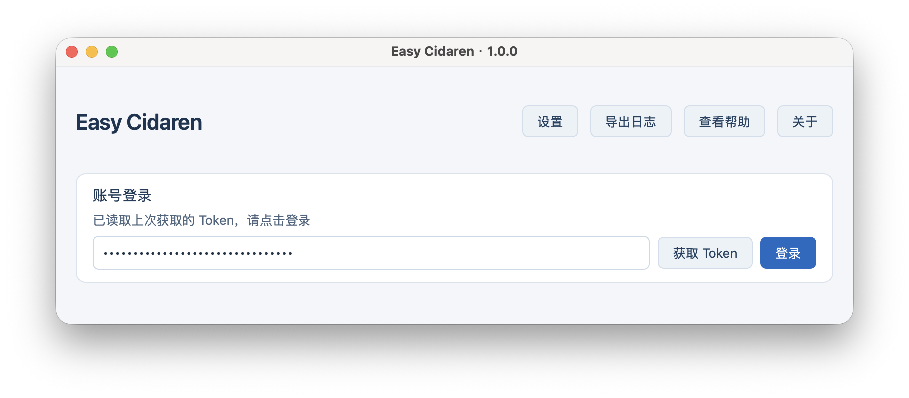
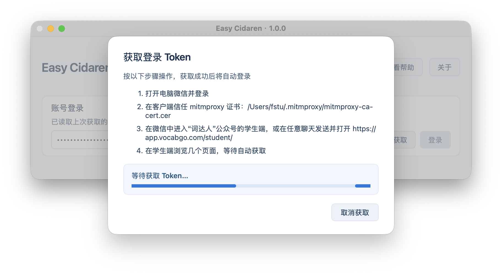
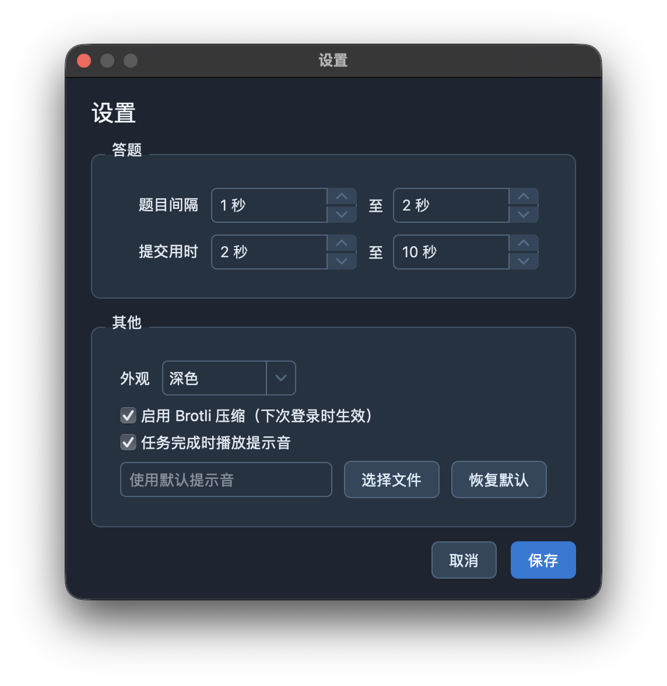
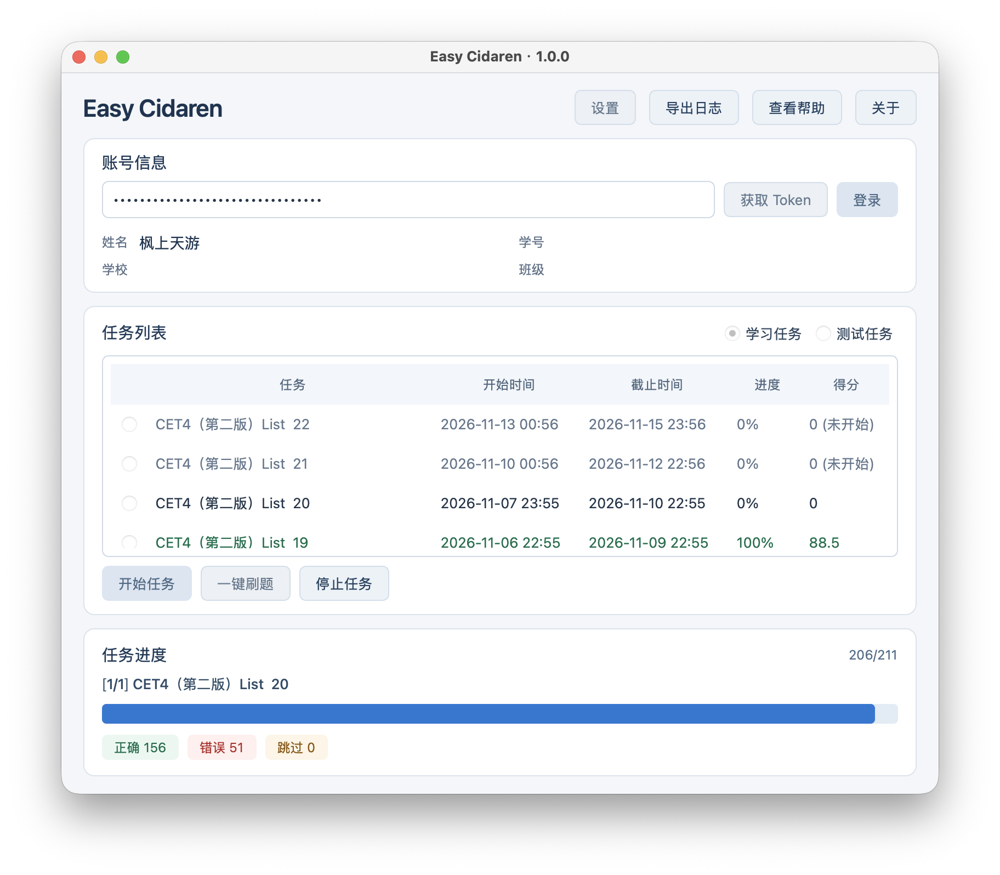

# Easy Cidaren

Easy Cidaren 是一个词达人自动刷题工具，支持 Windows、macOS 和 Linux。

- 本项目基于 [ularch/Easy_Cidaren](https://github.com/ularch/Easy_Cidaren) 修改，修改工作主要由 Codex 和 ChatGPT 完成。
- 本项目仅供个人学习使用，**请勿用于商业用途**。
- 遇到问题可在[项目问题区](https://github.com/fstyou/Easy_Cidaren/issues)反馈。

## 功能

- 自动作答学习任务和测试任务。
- 可手动选择单个任务作答，或一键作答所有已开始且未完成的任务。
- 支持重做已完成的任务。
- 支持查看任务进度。
- 支持调整答题间隔、提示音和浅色或深色主题。

## 界面预览

|              |  |
|:------------------------------------------:|:-------------------------------------------:|
|                  登录界面                  |                 获取 Token                  |
|  |         |
|                  设置界面                  |                  任务进度                   |

## 快速上手

1. 前往 [Releases](https://github.com/fstyou/Easy_Cidaren/releases/latest)，下载适合自己系统和架构的安装包，
   安装并打开 Easy Cidaren。
2. 登录词达人账号：
    - 如果本机保存了之前获取的 Token，可点击“登录”尝试使用，也可以手动输入 Token 并登录。
    - 初次使用 Easy Cidaren 或 Token 无效时，点击“获取 Token”，按照弹窗提示在**此电脑的微信**中打开词达人学生端。获取成功后会自动登录。
3. 选择“学习任务”或“测试任务”。
4. 开始自动作答：
    - 选择一个任务并点击“开始任务”，作答该任务。
    - 点击“一键刷题”，自动作答所有已开始且未完成的任务。
5. 执行期间**请勿在任何设备上打开词达人**并保持 Easy Cidaren 打开。如需中止，可点击“停止任务”。

### 获取 Token 的注意事项

- Windows 和 macOS 会尝试设置系统代理，结束后恢复原设置；期间系统可能要求授予权限，请批准。
- Linux 设备需手动设置 HTTP 和 HTTPS 代理为 `127.0.0.1:8888`，获取 Token 后需手动恢复为原设置。
- Windows 会尝试导入 mitmproxy 证书。
- macOS 和 Linux 需要根据弹窗提示手动信任 mitmproxy 证书。
- 获取 Token 期间端口 `8888` 必须可用。
- 若证书或代理设置未生效，请检查设备设置、手动添加并信任证书、手动添加和恢复代理，或者手动输入 Token。

## 开发

### 从源码运行

需要 Python 3.12 和图形桌面环境。

克隆仓库后，在项目根目录创建虚拟环境并安装依赖。  
Windows PowerShell 中使用以下命令创建并激活虚拟环境：

```powershell
py -3.12 -m venv .venv
.\.venv\Scripts\Activate.ps1
pip install -r requirements.txt
```

macOS 和 Linux 中使用以下命令创建并激活虚拟环境：

```bash
python -m venv .venv
source .venv/bin/activate
pip install -r requirements.txt
```

运行项目：

```bash
python main.py
```

Linux 还需要兼容的 Qt 图形库和音频服务，具体系统依赖随发行版而异。  
源码运行时，设置、Token 和日志保存在自动创建的 `runtime/` 中。

### 测试与打包

使用已安装依赖的 Python 环境，在项目根目录运行：

```bash
python -m unittest discover -s tests -v
python -u tests/gui_smoke.py
```

各平台打包方法及限制见[打包说明](build/README.md)。

### 项目结构

```text
main.py                 图形程序入口
easy_cidaren/           应用代码
  api/                  服务端接口与请求
  core/                 任务、答题与词库逻辑
  token_capture/        Token 捕获与代理
  ui/                   窗口、弹窗和设置
  paths.py              资源与运行数据路径
assets/                 程序图标、图片和提示音
data/                   答案库、词表池与语言模型
docs/                   项目文档相关文件
tests/                  自动化测试
build/                  打包脚本及说明
```

## 许可证

本项目采用 [GPL-3.0](LICENSE) 许可证。
